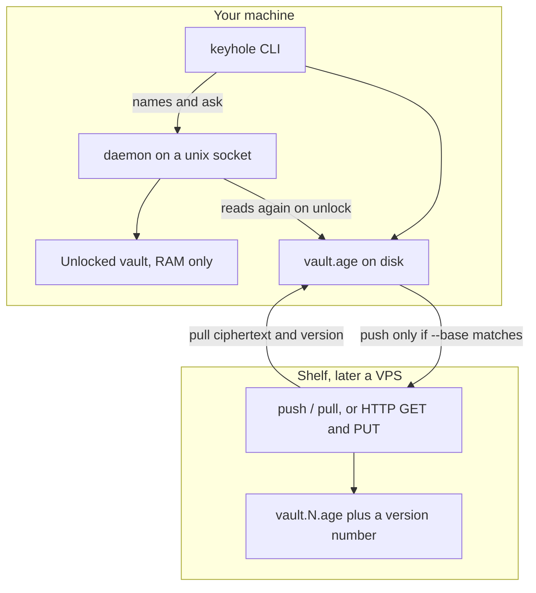
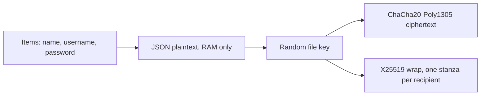
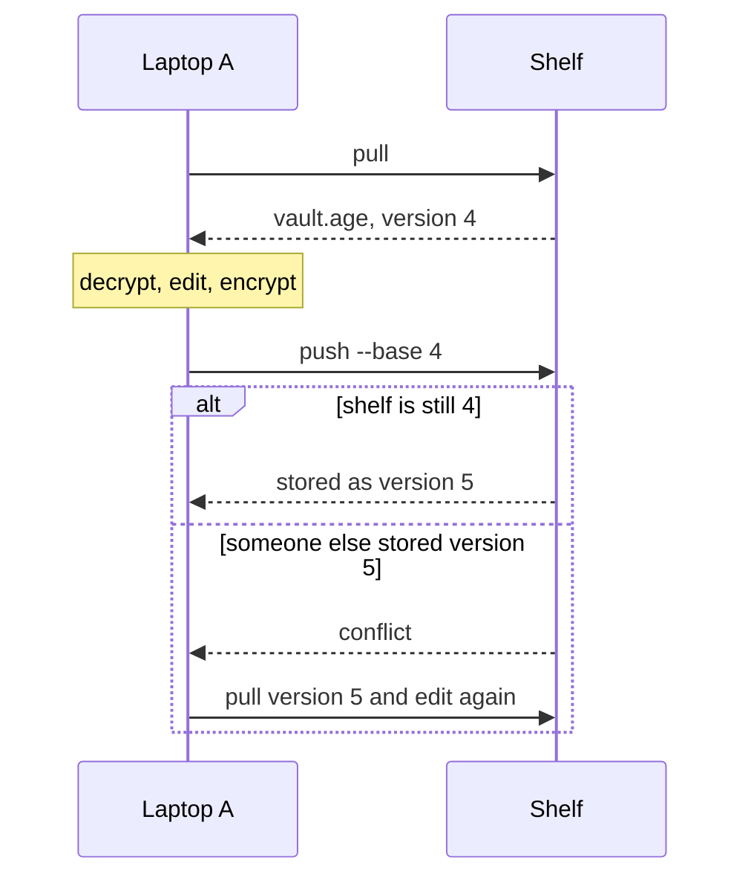

# Keyhole architecture

This is the picture of the system. Update it when the design changes.
GitHub renders the diagrams below.

Keyhole is one age file, unlocked on your machine. A shelf, when you use one, stores that file and a version number. The shelf does not decrypt.

## The machine and the shelf

`keyhole get` still decrypts the file itself, then exits. `keyhole daemon` decrypts once and keeps that plaintext in the process. `names` and `ask` talk to it over a unix socket in `$XDG_RUNTIME_DIR/keyhole/session.sock` (or `$KEYHOLE_SOCKET`). The socket is mode 600. There is no TCP port. After 300 seconds with no `names` or `ask`, or when you run `lock`, the process drops the plaintext and stays up. `unlock` reads the file again. A program running as you can still connect.

The operating system stores bytes and carries TCP. It does not know what a password is.
HTTPS, when the shelf is on another computer, is ordinary TLS around those same bytes.

## What sits inside an age file

| Piece | Role in Keyhole |
| --- | --- |
| File | The vault. Not a database server. Decrypting it yields a JSON list of items. |
| Cipher | ChaCha20-Poly1305, inside age. Hides the bytes and detects a changed byte. |
| Wrap | X25519. Each recipient gets one stanza in the header. Any one stanza opens the file. |
| KDF | Only if you use an age passphrase. age uses scrypt. A Bio recipient has no password KDF. |
| Account key | The random file key above. Your password or Bio only unwraps it. |
| Second door | WebAuthn on Vaultwarden today. Not part of this file yet. |

## Versioned push

Two laptops must not silently overwrite each other.

`keyhole push` implements this against a directory. `keyhole serve` exposes the same rule over HTTP on `/v1/vault`, with `If-Match` as the version you pulled and `X-Keyhole-Version` on the reply.

## Choices we are keeping

- **One encryption format: age.** GPG stays available for signatures. A menu of ciphers creates two ways to lose a vault.
- **X25519 and ChaCha20-Poly1305.** This is the current age design. A later hybrid post-quantum mode should arrive as an age upgrade, not as a second format.
- **The 1Password idea, in age's shape.** A stolen file must not be openable with only a password. Encrypt to the hardware recipients, and keep the identity off the shelf. A software identity sitting next to the vault is the practice setup, not the real one.
- **Argon2id and scrypt are the password KDFs to use.** There is not a stronger everyday replacement. More memory makes guessing harder until the unlock becomes unpleasant.
- **Secrets are typed at a prompt.** They are not command arguments, and they are not log lines. Error text does not include an item, a password, or the identity contents.
- **The process refuses three leaks.** Core dumps are off. `get` on a terminal uses the alternate screen and waits for Enter. The identity file must be mode 600 or 400, owned by you, and not a link.
- **`age`, `gpg`, and the Bio plugin are pinned.** Keyhole runs `/usr/bin/age` and `/usr/bin/gpg` only when their SHA-256 values match `age.pin` and `gpg.pin`. A Bio identity also requires `age-plugin-fido2-hmac` to match `fido.pin`, and that directory is put first on `PATH` for the `age` process. Those pins are compiled into the binary. An upgrade is `bash scripts/update-age-pin.sh`, `bash scripts/update-age-pin.sh gpg.pin`, or `bash scripts/update-age-pin.sh fido.pin`. The script asks for yes, rewrites the pin, and rebuilds.
- **An unlocked vault stays in RAM.** The decrypted bytes and the item strings are passed to `mlock`. The locked-memory limit is small, so the whole process is not locked. `mlock` does not hide the secret from another program you run, and it does not cover hibernation.
- **The shelf keeps five revisions.** After a successful push, older than the newest five `vault.N.age` files, and their signatures, are deleted. Those older copies are still openable by a Bio that was removed later. Five is enough to undo a bad edit. Single files such as a trial vault are not a shelf, so this rule does not delete them.
- **The shelf is not the trust.** A write to `serve` needs the token in `write.token`. This laptop appends the highest version it has seen and refuses an older one. `bash scripts/protect-highwater.sh` marks that directory append-only. A normal user cannot delete it or truncate a file the script has marked. Root can clear the flag. A vault opens only after a pinned OpenPGP key's signature checks. A signature made by a subkey is accepted when that subkey belongs to the pinned primary. `sign` uses your terminal so the Bio PIN prompt can open. Every age recipient must be pinned. The age header must contain the same number of X25519 stanzas as the vault lists. `rekey` is the explicit command that changes recipients.

## Where the shelf runs

The shelf listens on this machine at `127.0.0.1`, or later on a Tailscale address. It has no public port. Tailscale already hides the café address from the VPS. A Mullvad exit node is for browsing the public web. Vault sync stays on the tailnet.

PiKVM stores no vault secrets. The laptop's system disk encryption is a later maintenance window.

## Not built yet

A browser extension that can ask this daemon for one confirmed origin. The page does not open the socket. The daemon does not hide its memory from another program you run.
