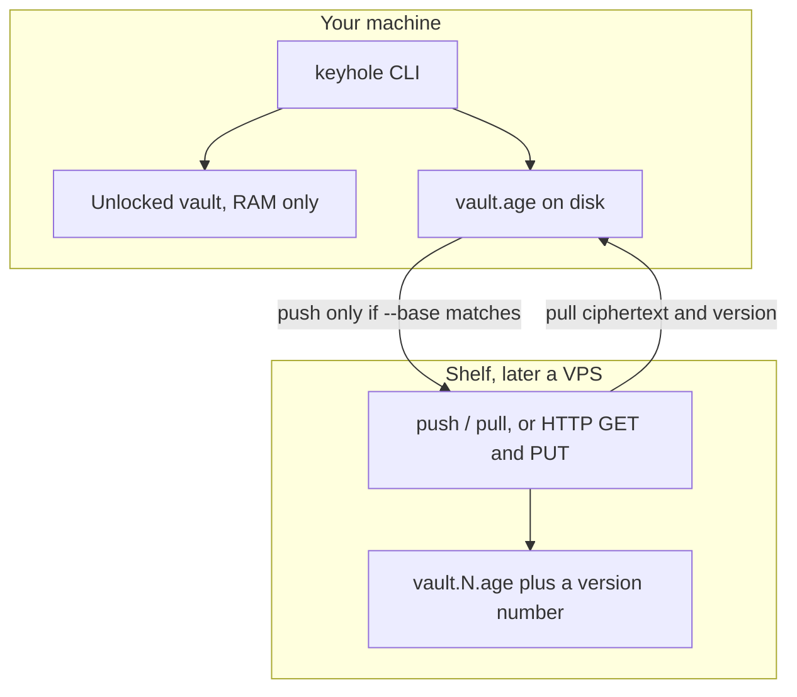
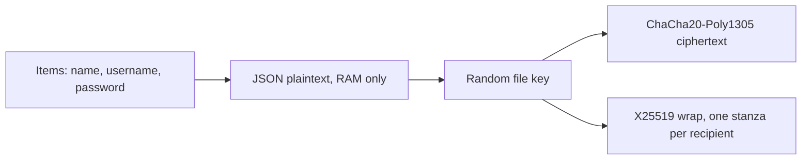
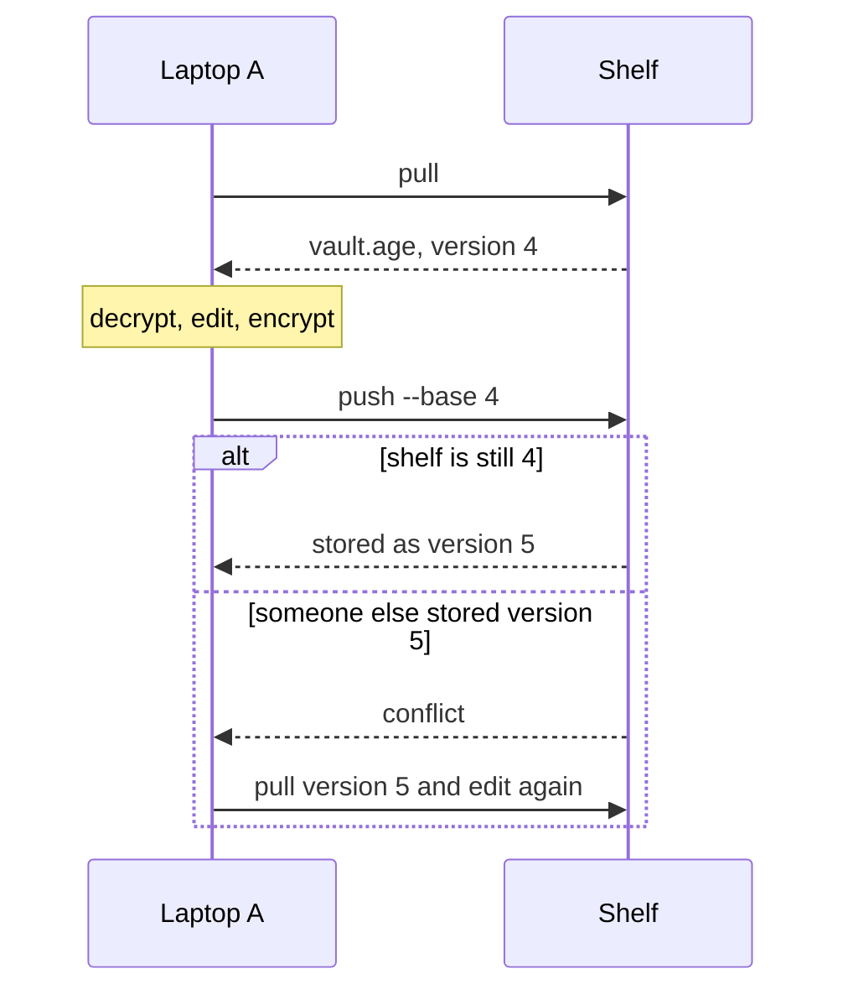

# Keyhole architecture

This is the picture of the system. Update it when the design changes.
GitHub renders the diagrams below.

Keyhole is one age file, unlocked on your machine. A shelf, when you use one, stores that file and a version number. The shelf does not decrypt.

## The machine and the shelf

The operating system stores bytes and carries TCP. It does not know what a password is.
HTTPS, when the shelf is on another computer, is ordinary TLS around those same bytes.

## What sits inside an age file

| Piece | Role in Keyhole |
| --- | --- |
| File | The vault. Not a database server. Decrypting it yields a JSON list of items. |
| Cipher | ChaCha20-Poly1305, inside age. Hides the bytes and detects a changed byte. |
| Wrap | X25519. Each recipient gets one stanza in the header. Any one stanza opens the file. |
| KDF | Only if you use an age passphrase. age uses scrypt. A Bio recipient has no password KDF. |
| Account key | The random file key above. Your password or Bio only unwraps it. |
| Second door | WebAuthn on Vaultwarden today. Not part of this file yet. |

## Versioned push

Two laptops must not silently overwrite each other.

`keyhole push` implements this against a directory. `keyhole serve` exposes the same rule over HTTP on `/v1/vault`, with `If-Match` as the version you pulled and `X-Keyhole-Version` on the reply.

## Choices we are keeping

- **One encryption format: age.** GPG stays available for signatures. A menu of ciphers creates two ways to lose a vault.
- **X25519 and ChaCha20-Poly1305.** This is the current age design. A later hybrid post-quantum mode should arrive as an age upgrade, not as a second format.
- **The 1Password idea, in age's shape.** A stolen file must not be openable with only a password. Encrypt to the hardware recipients, and keep the identity off the shelf. A software identity sitting next to the vault is the practice setup, not the real one.
- **Argon2id and scrypt are the password KDFs to use.** There is not a stronger everyday replacement. More memory makes guessing harder until the unlock becomes unpleasant.
- **Secrets are typed at a prompt.** They are not command arguments, and they are not log lines.

## Not built yet

A long-running daemon, a browser extension, and a phone client.
The shelf listens only where you bind it. `127.0.0.1` is the right first address.
